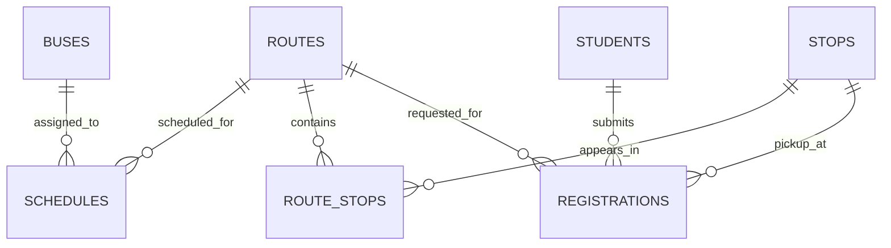

# Database Schema Plan

**Status:** Proposed design only; tables and migrations have not yet been implemented.

## Design principles

- Use primary keys for every entity.
- Add foreign keys to protect relationships.
- Store schedule times and dates consistently; document the university's timezone as `Asia/Dhaka`.
- Do not store unnecessary personal data.
- Use synthetic data while developing.
- Enforce seat/capacity rules in a database transaction when seat allocation is implemented.

## Proposed entities

### `buses`
| Column | Type | Notes |
|---|---|---|
| `id` | BIGSERIAL PK | Unique bus record |
| `bus_code` | VARCHAR(30) UNIQUE | Internal fleet code |
| `registration_number` | VARCHAR(30) UNIQUE, nullable | Vehicle registration, if authorized for use |
| `capacity` | INTEGER | Must be greater than zero |
| `status` | VARCHAR(20) | For example: active, maintenance, inactive |
| `created_at` | TIMESTAMPTZ | Creation timestamp |

### `routes`
| Column | Type | Notes |
|---|---|---|
| `id` | BIGSERIAL PK | Unique route |
| `route_name` | VARCHAR(120) | Human-readable route name |
| `start_point` | VARCHAR(160) | Starting point |
| `end_point` | VARCHAR(160) | Destination |
| `is_active` | BOOLEAN | Whether the route is available |

### `stops`
| Column | Type | Notes |
|---|---|---|
| `id` | BIGSERIAL PK | Unique stop |
| `stop_name` | VARCHAR(160) | Stop label |
| `area_name` | VARCHAR(160), nullable | Local area |
| `latitude` | NUMERIC, nullable | Optional map coordinate |
| `longitude` | NUMERIC, nullable | Optional map coordinate |

### `route_stops`
A many-to-many join table that also stores the order of stops on a route.

| Column | Type | Notes |
|---|---|---|
| `route_id` | BIGINT FK → routes.id | Route |
| `stop_id` | BIGINT FK → stops.id | Stop |
| `stop_order` | INTEGER | Position along the route |
| `estimated_minutes_from_start` | INTEGER, nullable | Planned travel offset |

**Suggested constraints:** composite primary key `(route_id, stop_id)` and unique `(route_id, stop_order)`.

### `schedules`
| Column | Type | Notes |
|---|---|---|
| `id` | BIGSERIAL PK | Schedule entry |
| `bus_id` | BIGINT FK → buses.id | Assigned bus |
| `route_id` | BIGINT FK → routes.id | Assigned route |
| `departure_time` | TIME | Local departure time |
| `service_days` | JSONB or normalized child table | Days on which the service runs |
| `effective_from` | DATE, nullable | Schedule start date |
| `effective_until` | DATE, nullable | Schedule end date |
| `is_active` | BOOLEAN | Whether schedule is current |

For a larger production system, consider a separate `schedule_days` table and dated `trips` rather than storing recurring days in JSONB.

### `students`
| Column | Type | Notes |
|---|---|---|
| `id` | BIGSERIAL PK | Internal student record |
| `student_id` | VARCHAR(40) UNIQUE | University identifier; use only with authorization |
| `full_name` | VARCHAR(160) | Student name |
| `email` | VARCHAR(254), nullable | Contact email if needed |
| `created_at` | TIMESTAMPTZ | Creation timestamp |

Do not use real student information in the public demo database. Authentication credentials, if added, should be stored separately and passwords must be securely hashed.

### `registrations`
| Column | Type | Notes |
|---|---|---|
| `id` | BIGSERIAL PK | Request ID |
| `student_id` | BIGINT FK → students.id | Applicant |
| `route_id` | BIGINT FK → routes.id | Requested route |
| `preferred_stop_id` | BIGINT FK → stops.id | Requested pickup stop |
| `status` | VARCHAR(20) | pending, approved, rejected, cancelled |
| `requested_at` | TIMESTAMPTZ | Submission time |
| `reviewed_at` | TIMESTAMPTZ, nullable | Review time |

Add a uniqueness rule only after deciding the policy—for example, whether a student may have one active registration per semester or multiple route requests.

## Relationships

## Future tables to consider

- `users` and `roles` for authentication and permissions
- `trips` for a specific dated bus departure
- `seat_assignments` if named seat allocation is required
- `announcements` for schedule changes
- `audit_logs` for tracking administrative changes

## Before implementation

1. Confirm the exact business rules.
2. Review data privacy and authorization requirements.
3. Convert this proposal into SQL migrations.
4. Add constraints and indexes.
5. Test with synthetic records.
